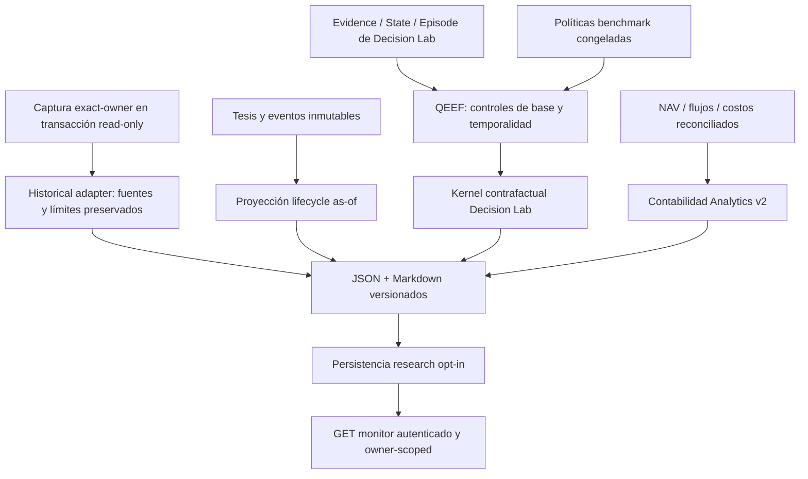

# QEEF: arquitectura implementada

## Extensión Phase 2

Sobre el cierre v1 `08623cc9b418d7aef4da89b020ec26737a20d455`, Phase 2 incorpora captura fail-open en persistencia de planes, snapshots, fills y mercado; spool SQLite; eventos/jobs PostgreSQL; scanner de recuperación; evaluación desde outcomes; monitor JSON/Markdown y `/qeef` opcional. Implementación: `c25e637`.

Los módulos nuevos son `prospective`, `hooks`, `delivery`, `worker`, `recovery`, `transitions`, `market`, `adapters`, `accounting` y `monitor`. Se reutilizan el estado/simulador de Decision Lab y la contabilidad Analytics v2, extendida únicamente para cargos observados no asociados a fills. Migración aditiva: `20261014_qeef_prospective.sql`.

La captura permanece apagada. RESEARCH_ONLY y autoridad económica false son constantes. El flujo, contratos y límites actuales están en [QEEF_PROSPECTIVE_PIPELINE.md](QEEF_PROSPECTIVE_PIPELINE.md) y [QEEF_ACCOUNTING_RECONCILIATION.md](QEEF_ACCOUNTING_RECONCILIATION.md). Las secciones siguientes conservan la arquitectura de cierre v1; la referencia a una sola tabla corresponde a esa versión, no al total Phase 2.

Versión `qeef-v1.0.0`, modo único `RESEARCH_ONLY`. Implementación: `d3cca84c06f631773810b4aec5077c35f157aafb`. No contiene generador de órdenes ni ruta de activación.

## Composición y flujo

No se duplican `ExecutionPlan`, portfolios, fills, calendario ni contabilidad. Se reutilizan `Frozen`, `Evidence`, `State`, `Episode`, `Order`, serialización canónica/digest, simulador Decision Lab, `economic_pnl`, `equity_metrics` y bootstrap por fecha. Se agrega una sola tabla opcional de artefactos; las relaciones se expresan por IDs y hashes existentes.

## Módulos funcionales

| Archivo | API | Función y límite |
|---|---|---|
| [contracts.py](../../src/analysis/qeef/contracts.py) | `Gate`, `Condition`, `Thesis`, `ThesisEvent`, `Benchmark` | Tipos inmutables; razones de estados; owner, objetivos, fuentes, reloj y política |
| [lifecycle.py](../../src/analysis/qeef/lifecycle.py) | `project_thesis` | Proyección as-of; deduplicación, cierre, censura y no reescritura de objetivos |
| [counterfactuals.py](../../src/analysis/qeef/counterfactuals.py) | `freeze_alternatives`, `evaluate_counterfactuals`, `sensitivity` | Estado común, alternativas registradas, guardas de precios/ratio/owner; costos explícitos |
| [metrics.py](../../src/analysis/qeef/metrics.py) | `detection_quality`, `thesis_quality` | Universo/labels completos y definición económica; soporte/contradicción sin score de cantidad |
| idem | `allocation_quality`, `compare_allocations` | Concentración, pesos, cash, sectores, covarianza opcional y cambios de asignación |
| idem | `realized_value`, `execution_quality` | Contabilidad reconciliada; fills reales completos/parciales y shortfall separado |
| idem | `paired_confidence`, `multiple_testing`, `attribution` | Cohortes y dependencia; BH; contrastes de modelo sin porcentajes causales |
| [historical.py](../../src/analysis/qeef/historical.py) | `adapt_history`, `compare_history`, `legacy_lab_comparison` | Censo estable, comparaciones con mismos registros, legacy aislado; no crea tesis canónicas |
| [service.py](../../src/analysis/qeef/service.py) | `evaluate`, `audit_capture`, `write_report` | Servicio de evaluación y reporte determinista, identidad por contenido |
| [store.py](../../src/analysis/qeef/store.py) | `append_artifact`, `latest_evaluation` | Persistencia opcional, idempotente, append-only, owner exacto; nunca instala esquema implícitamente |
| [capture_qeef.py](../../scripts/capture_qeef.py) | CLI | Captura privada repeatable-read, sin bootstrap ni exportación de credenciales |
| [run_qeef.py](../../scripts/run_qeef.py) | `audit`, `evaluate` | Ejecución offline; JSON+Markdown, hash de inputs/código/dependencias |
| [monitor/qeef.py](../../src/monitor/qeef.py) | `qeef_view` | Lectura `/api/economic-evaluation` bajo autenticación existente; owner distinto→403 |

`service.evaluate` integra episodio/contrafactuales, asignación inicial, contabilidad opcional y salida de seis dimensiones. Detección y tesis quedan `NOT_IDENTIFIABLE` si no se les aporta evidencia; sus APIs separadas son funcionales, pero el CLI v1 no carga universos/tesis/ablaciones automáticamente. `paired_confidence` agrega episodios mediante API; una evaluación individual informa n=1. Esta frontera evita presentar integración prospectiva aún no activada como completa.

## Identidades y ciclo de tesis

`opportunity_id` identifica la oportunidad económica declarada. `thesis_id` identifica una formulación congelada, con `thesis_opened_at`, `recorded_at`, horizonte, targets, invalidadores, fuentes y calidad. Actualizaciones enlazan `decision_id`, `recommendation_id`, `plan_id` y `execution_id` existentes. `evaluation_id` es digest del resultado y su procedencia.

Nueve HOLD y un BUY pueden pertenecer a una misma tesis: 10 decisiones, una tesis y una oportunidad. Una nueva intención después del cierre requiere otra tesis. El framework no decide semánticamente cuándo una recomendación nueva es una nueva oportunidad: el productor prospectivo debe declarar esa identidad. El adaptador no inventa esa relación; ofrece un proxy separado de recurrencias con brecha máxima de siete días calendario.

Eventos soportados: `UPDATE`, `TARGET`, `INVALIDATION`, `POSITION_CLOSED`, `REGIME_CHANGE`, `EXPIRED`. Targets/invalidadores exigen observación que coincida con campo, operador, valor, unidad y fuente congelados. `POSITION_CLOSED` exige ejecución. Expiración por sesiones exige conteo y referencia de calendario; por evento exige condición objetiva. Cambio de régimen es motivo de cierre, no éxito económico automático. No hay PnL por el mero cierre.

`current_status`, `closed_at`, `closure_reason` y censura se calculan desde los eventos disponibles al corte. Eventos posteriores no alteran vistas anteriores. Contratos históricos inferidos nunca pueden declarar calidad HIGH. El almacenamiento serializa eventos de una tesis para evitar cierres concurrentes incompatibles.

## Seis dimensiones y separación de estados

| Dimensión | Resultado | Requisitos mínimos |
|---|---|---|
| A. Opportunity Detection | Precision/recall, omisiones, NDCG y selección aleatoria | Universo elegible completo y regla ex ante de riesgo, costo, liquidez y horizonte; labels posteriores disponibles |
| B. Research & Thesis | Calidad de referencias, soporte/contradicciones | Evidencia relevante, fechas y fuentes; fundamentos revisados requieren versión disponible entonces |
| C. Decision Quality | Factibilidad ex ante y delta contrafactual ex post | Portfolio/plan congruentes, precios/acciones corporativas, alternativas congeladas |
| D. Allocation Quality | Pesos, concentración, límites, contribución de riesgo | Pesos reconciliados; matriz PIT alineada para riesgo; factores/FX/liquidez explícitos |
| E. Realized Economic Value | PnL, TWR y riesgo de cuenta | Fills/costos, NAV y flujos reconciliados; datos contrafactuales nunca se convierten en realizados |
| F. Confidence | DATA_QUALITY, STATISTICAL_CONFIDENCE, ECONOMIC_PERFORMANCE | Cohorte/versiones/digest/cobertura/dependencia; sin score global |

`VERIFIED` certifica el cálculo dentro de su contrato y evidencia, no una ventaja económica. `PARTIAL` conserva resultados descriptivos limitados. `INSUFFICIENT_DATA` incluye madurez/muestra insuficiente. `NOT_IDENTIFIABLE` indica que el estimando no puede recuperarse con esa evidencia. `INVALID` indica contradicción del contrato. Las APIs estrictas también rechazan inputs inválidos con `ValueError`; el caller no debe convertirlos en PASS.

No se atribuyen resultados por asociación verbal a Radar, Technical, Fundamental, Macro, Risk, Decision Engine, Meta, Optimizer, Planner, Collector o Execution. Sólo se informa contraste de modelo cuando la ablación registra iguales inputs/estado/costo/horizonte y políticas previas. Incluso entonces el estado es PARTIAL: no identifica causalidad real.

## Datos, reporte y monitor

La [migración](../../migrations/20261014_qeef_v1.sql) agrega `qeef_artifacts`, con clave `(owner_chat_id, kind, artifact_id)` para THESIS/THESIS_EVENT/EVALUATION, JSONB, digest, versión, cutoff y reloj lógico de evaluación. RLS usa `qeef.owner`; triggers impiden UPDATE/DELETE/TRUNCATE. Roles superuser/BYPASSRLS no son una frontera de aislamiento: el despliegue debe usar roles mínimos y la validación del servicio. No se aplicó a la base operativa.

Cada evaluación incluye metodología, SHA/hash de código, evidencia, as-of, evaluated_at, cohorte, benchmark, costos, referencias y flags false. `evaluated_at` es **tiempo lógico fijado al cutoff** para reejecución idéntica; `created_at` de persistencia es reloj de inserción. Un reporte existente sólo se acepta si coincide byte a byte; otro resultado exige directorio/ID nuevo.

La ruta del monitor reutiliza `api.py`, autenticación y pool. Consulta únicamente el owner configurado; esquema ausente devuelve estado explícito. No se creó un frontend, no se desplegó la ruta ni se modificó Telegram. El almacenamiento y endpoint se verificaron de forma aislada; no se afirma prueba de navegador o tráfico HTTP en producción.

## Dashboard de cuatro niveles propuesto sobre la infraestructura existente

| Nivel | Paneles | Comportamiento ante faltantes |
|---|---|---|
| 1. Resultado económico | NAV, PnL realizado/no realizado, retorno neto, benchmark, drawdown, riesgo y contribución | No graficar como cero; mostrar estado, moneda, cutoff, cobertura y fórmula |
| 2. Calidad de decisiones | Deltas PLAN−alternativas, detección/omisiones medibles, costos evitados, asignación y factibilidad | Diferenciar simulado, recomendado, plan, fill, realizado y contrafactual |
| 3. Diagnóstico | Ablaciones disponibles, timing, sobreoperación, recurrencias, concentración, cambios de tesis y pronóstico | Sin causalidad atribuida si faltan variantes controladas; no contar updates como oportunidades |
| 4. Confiabilidad | Cobertura, PIT, n decisiones/tesis/episodios/no solapados, intervalos, costos y benchmarks | Denominador completo y censura visibles; calidad y performance en campos separados |

Este esquema de UI está diseñado, no implementado como pantalla nueva. El endpoint JSON y reporte son la integración funcional de v1.
