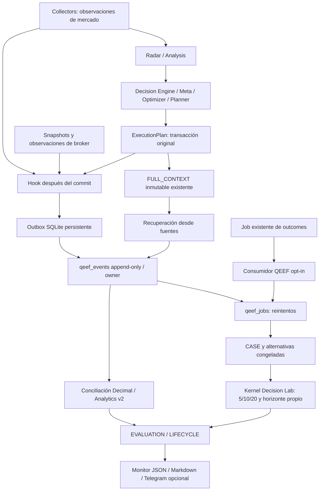

# QEEF Phase 2 — pipeline prospectivo

Estado: implementación research preparada para revisión. Captura y Telegram desactivados por defecto. No se desplegó ni migró la base operativa. La evidencia histórica mantiene su clasificación v1.

## Integración real

No hay flechas de retorno hacia las decisiones. Los hooks no cambian scores, pesos, órdenes, ni respuestas de `/analisis`, `/portfolio` o `/agente`.

| Origen | Punto implementado | Evidencia |
|---|---|---|
| Plan formal | `scripts/run_analysis.py::_save_execution_plan_events`, después del commit | FULL_CONTEXT, IDs de decisiones/intents, cartera, señales, macro, eventos, hashes |
| Cartera | `PortfolioDatabase.save_snapshot`, después de guardar | Snapshot y posiciones originales; `total_value_ars` es valor invertido, cash separado |
| Ejecuciones | `PortfolioDatabase.save_broker_fills` y refrescos FULL/intraday después de conciliación | Versiones de fills, costos observados, vínculos almacenados |
| Movimientos | Refrescos broker FULL/intraday con owner de sesión explícito | Movimientos sin raw payload, cobertura UNKNOWN |
| Mercado | `persist_candle_observations` | Instrumento, precios y metadatos versionados existentes |
| Outcomes | `run_update_outcomes` | Entrega, recuperación, consumo, programación de evaluaciones y conciliación |

El hook de mercado puede ejecutarse dentro de una transacción exterior del collector: su observación no prueba que esa transacción exterior haya hecho commit. El payload conserva la observación recibida. Radar y resultados de análisis se capturan como inputs del plan cuando están presentes; no se crea una segunda oportunidad canónica para cada fila del radar.

## Contratos y límites

`CaptureEvent` tiene owner, tipo, identidad/version de fuente, effective_at, available_at, payload canónico, hash y parent opcional. Proveniencia: RECORDED, RECOVERED_IMMUTABLE, RECOVERED_CURRENT, DERIVED o SYNTHETIC_TEST. `event_id` depende de owner/tipo/fuente/version. Un reintento idéntico conserva la primera disponibilidad registrada. La evidencia es inmutable; la metadata de entrega sí evoluciona.

`DecisionBundle` acepta Episode/State/CostModel de Decision Lab y benchmarks ex ante. Verifica owner, tiempos, opportunity_id de tesis, ticker del plan, snapshot, cash, cantidades/precios iniciales y órdenes contra la captura original. `freeze_alternatives` se ejecuta al construir CASE; la evaluación posterior usa exactamente el Episode almacenado. No vuelve a elegir alternativas con precios futuros.

Los productores actuales no suministran todos los contratos tipados. El hook captura igualmente el plan nativo como PARTIAL: conserva PLAN, NO_TRADE y HOLD_EXISTING con las limitaciones observadas; CASH o benchmarks sin factibilidad/selección documentada quedan NOT_IDENTIFIABLE. No se inventan órdenes de liquidación ni costos conocidos.

El parámetro opcional `qeef_bundle` permite a un productor entregar evidencia completa. No se construye automáticamente una hipótesis a partir del score. Si un bundle adicional existe sólo en memoria y falla su escritura local, la recuperación FULL_CONTEXT conserva los hechos originales pero no puede reconstruir esa extensión perdida. Para garantizar su recuperación, el productor futuro debe conservar la declaración en su evidencia inmutable original. Este límite queda fuera de cualquier afirmación de captura completa.

## Identidad y lifecycle

Una declaración necesita `source_id`, `source_thesis_key`, hipótesis, ticker, estrategia, clocks, horizonte, condiciones objetivas y referencias. Los IDs se derivan determinísticamente de owner y clave explícita del productor. El mismo ticker o score no establece identidad. Una recurrencia con el mismo ID conserva objetivos; una declaración incompatible con el mismo ID es rechazada.

OPENED se representa por la tesis inmutable. UPDATED agrega observaciones. CONFIRMED valida un objetivo congelado y conserva la tesis activa. INVALIDATED exige condición, valor, fuente y unidad coincidentes. CLOSED exige referencia de ejecución; no se deduce de un SELL recomendado. EXPIRED necesita calendario/sesiones o días calendario según contrato. REGIME_CHANGE requiere evento explícito. Sin cierre, el resultado queda censurado al corte.

La evaluación automática observa condiciones de precio/close sobre barras cerradas RAW_AS_TRADED y fuente/unidad exactas; sólo hasta el horizonte propio. Una invalidación simultánea prevalece sobre confirmación, sin inventar secuencia intradiaria. Condiciones fundamentales o de eventos requieren un `THESIS_EVENT` explícito con evidencia; el pipeline no las convierte en condiciones de precio. Una referencia textual de ejecución preservada no certifica por sí sola conciliación de cuenta.

## Datos de mercado

`MarketFact` exige identidad y clocks; las propiedades no disponibles quedan UNKNOWN. El adapter acepta únicamente sesiones con apertura/cierre explícitos, versión de calendario conocida al decidir, moneda/unidades, precio no ajustado, cierre confirmado, ratio/version de CEDEAR y cobertura de corporate actions documentada. No deduce feriados ni relación CEDEAR/subyacente de un ticker. No incorpora un proveedor nuevo.

Una revisión posterior no se utiliza antes de su disponibilidad. El historial corto devuelve INSUFFICIENT_DATA. Los 28.615 registros del corte histórico son PARTIAL bajo el contrato nuevo: esto es un diagnóstico de completitud, no una modificación de v1.

## Entrega y recuperación

- SQLite usa WAL, synchronous FULL y triggers contra modificación/borrado de payload. Timeout de lock 0,1 s; fábrica y escritura del hook tienen límites de 1 s cada una. Un timeout puede terminar mientras el thread completa la escritura: la idempotencia tolera el reintento.
- La operación original continúa ante excepción de QEEF. Se registra código de error sanitizado; no se imprimen DSN, credenciales o payloads.
- El consumidor inserta el evento y su job en transacción. Los efectos y DONE se confirman juntos. Una caída tras commit y antes del acuse local genera un reintento idéntico.
- RETRY tiene backoff exponencial con máximo 3.600 s; después de 10 intentos pasa a DEAD_LETTER. La recuperación de un dead letter exige investigar el error y reencolar su metadata, sin editar evidencia.
- El scanner recupera planes FULL_CONTEXT, snapshots y observaciones inmutables desde el inicio explícito de activación, por lotes de 100. Los planes previos al inicio no se promueven como prospectivos.
- Los fills son mutables: se observan versiones actuales con disponibilidad de recuperación, nunca retrodatada. El scan cubre hasta 5.000 filas por ciclo y señala truncamiento. Ese límite requiere ampliación antes de superar el volumen admitido.
- `broker_movements` no tiene owner canónico: no se asignan sus filas históricas por heurística. Una captura fallida exige reobservación de la sesión correcta; el denominador total queda UNKNOWN. No se garantiza recuperación de movimientos que ya no estén disponibles en origen.

La spool debe ubicarse en almacenamiento persistente del proceso real. No hay garantía de durabilidad frente a pérdida simultánea del disco y de la fuente; se necesita backup y retención. No se afirma un SLO de latencia/capacidad no probado.

## Monitor y operación

`GET /api/qeef-evidence` reutiliza la autenticación del monitor y sólo permite `TELEGRAM_CHAT_ID`. `?format=markdown` entrega Markdown; el default es JSON. No instala esquema. `/qeef` se registra únicamente con `QEEF_TELEGRAM_ENABLED=true`, y verifica además el owner exacto. Las pruebas de Telegram usan stubs, sin mensajes reales ni validación del gateway en producción.

`python scripts/run_qeef_pipeline.py status --output <directorio>` abre transacción read-only y produce status.json/status.md. `work` requiere captura habilitada y sólo escribe tablas/spool QEEF; no instala migraciones. Requiere DATABASE_URL por entorno, nunca como argumento o log. `scripts/run_qeef.py evaluate` sigue siendo la evaluación offline sin DB.

El monitor separa conteos de versiones y fuentes únicas, esperados/ausentes desde activación, jobs RETRY/DEAD_LETTER, duplicados, lag, tesis sin vínculo, estados PIT y conciliación. `evaluations_mature` cuenta casos con PLAN verificable en todos los horizontes solicitados; no es simplemente edad calendario ni rentabilidad realizada. `reconciliation_versions` cuenta versiones de conciliación, no períodos independientes. No suma retornos de decisiones para producir una curva de cuenta.

Las tablas y métricas no hacen avanzar la política ni habilitan promoción. Todos los productos mantienen RESEARCH_ONLY y las tres autoridades en false.
