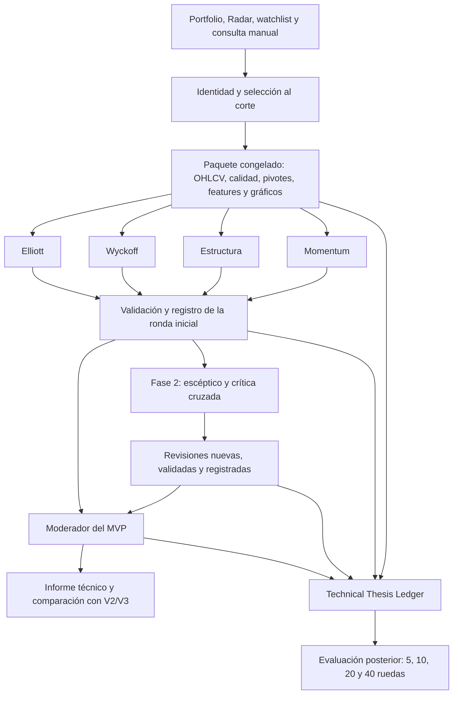

# Quantia — Technical Analysis Desk

Revisión y diseño técnico · 14 de noviembre de 2026 · **PROPUESTA, SIN IMPLEMENTACIÓN DEL DESK**

## Decisión recomendada

Construir `src/technical_desk/` como fuente de interpretación **SHADOW_ONLY**, con cuatro especialistas, validación programática y moderación. Reutilizar las capacidades de datos, indicadores, gráficos y transporte de Quantia mediante adaptadores. Mantener contratos propios: el `thesis_desk` existente investiga hechos empresariales y simula una cartera paper; su semántica es diferente.

La propuesta es viable como desarrollo incremental. Su capacidad predictiva y el beneficio de debatir entre agentes siguen **NO EVALUADOS**. Un conteo compatible con las reglas, una explicación convincente o cuatro opiniones coincidentes no demuestran acierto futuro.

Cambios recomendados sobre la secuencia original:

1. Incorporar el registro inmutable y el protocolo de evaluación **desde el MVP**. Posponer las métricas detalladas, pero conservar desde el primer día lo que realmente se predijo.
2. Separar interpretación, validación de reglas y resultados futuros en contratos diferentes.
3. Mantener explícita la posibilidad de abstenerse, discrepar o terminar una corrida parcial.
4. Usar una ruta específica para consultas técnicas: `/analisis` ya tiene otra función.
5. Iniciar con datos estructurados y gráficos reproducibles. La lectura visual por modelos será una capacidad opcional, evaluada contra la versión sin imágenes.

## Alcance y evidencia de esta revisión

Se inspeccionó el checkout principal `C:\Users\Franco\OneDrive\Escritorio\backend\cocos_copilot`, rama `feature/quantia-opportunities-v1-20261015`, HEAD `661236a0bdbe1e4999221ecd498ca5d2efd4e71a`. Había cambios locales y archivos sin seguimiento, incluido `src/thesis_desk/`; por eso HEAD por sí solo no reproduce el estado inspeccionado. La revisión describe esos archivos locales, no certifica qué está desplegado.

La revisión inicial inspeccionó código y ejecutó pruebas locales. La ampliación solicitada consultó la base configurada `quantia` con owner explícito, `REPEATABLE READ` y `transaction_read_only=on`, y contrastó los lectores de Radar desplegados. El [informe de etapa 0](technical-analysis-desk-stage0.md) contiene fechas, cohortes, conteos por versión/ticker/fecha y límites de esa evidencia. No se invocaron modelos ni se enviaron mensajes a Telegram. Proveedor del futuro Desk y capacidad del hardware siguen sin medirse. Las rutas futuras mencionadas abajo son propuestas.

### Capacidades existentes y límites

| Capacidad | Evidencia local | Uso propuesto / límite |
|---|---|---|
| Indicadores deterministas y calidad | `src/analysis/technical.py:243`, `:557`; `src/analysis/contextual_contracts.py:25` | Reutilizar RSI, MACD, medias, ATR y diagnósticos. La existencia del cálculo no garantiza suficiente historia ni procedencia válida. |
| Identidad de serie y metadatos | `src/collector/cocos_history.py:105` | Ya distingue mercado, moneda, instrumento, intervalo y política de ajustes; conservarlos al transformar datos. |
| Evidencia versionada al corte | `src/collector/contextual_g2.py:508`, `:593`, `:632` | Priorizar `read_market_evidence_as_of`: filtra cierre, disponibilidad, registro y estado de captura; verifica digests. Verificar cobertura antes de asumir que puede abastecer el Desk. |
| Lectura corriente de velas | `src/collector/db.py:2167` | Tiene filtros de identidad y corte, pero usa `market_candles`. No sustituye automáticamente un archivo de versiones históricas. |
| Informe y gráficos por ticker | `src/analysis/ticker_technical_report.py:91`, `:132`, `:337` | Reutilizar presentación/cálculos mediante adaptador. Su fallback a yfinance puede cambiar la lectura a USD: no usarlo como sustitución silenciosa de una serie local. |
| Señales V2/V3 | `src/analysis/technical_shadow_v2.py:21`; `src/analysis/technical_buy_shadow_v3.py:17` | Incorporar como comparación identificada en la síntesis; conservar sus cohortes y sus restricciones de autoridad. |
| Seguimiento de Radar | `src/analysis/radar_exploratory.py:325` | Hay una watchlist de acciones FOLLOW. No equivale a una lista libre de símbolos; tiene filtros temporales y su lectura llama `ensure_schema`. Diseñar un adaptador realmente de lectura. |
| Desk empresarial existente | `src/thesis_desk/agents.py:136`, `:223`; `src/thesis_desk/workflow.py:12` | Reutilizar patrones de presupuesto, auditoría y parsing; los roles Research/Contrarian/PM no son los analistas técnicos propuestos. |
| Transporte de modelos | `src/agentic/model_transport.py:40`; `src/thesis_desk/agents.py:64`, `:216` | El camino OpenRouter pide `json_object`; el local puede recibir schema. Aplicar el mismo contrato y control de truncamiento después de ambos. |
| Caché y estado paper | `src/thesis_desk/paper.py:45` | Permiten reemplazar caché y actualizar estado. No reutilizarlos como ledger inmutable. |
| Horizontes de resultados | `src/analysis/radar_discovery.py:1491`; `src/analysis/plan_follow_attribution.py:104` | Hay semánticas diferentes: enésima vela disponible frente a sesión exacta del calendario. El Desk debe fijar una sola convención. |
| Telegram | `scripts/telegram_bot.py:3157`, `:3192`, `:3798`, `:3815` | `/analisis` despacha el análisis general; `/ticker`, `/tecnico` y `/accion` comparten consulta por símbolo. |

En la búsqueda acotada a `src`, `tests` y `docs` no se encontró implementación de Elliott, Wyckoff ni debate técnico de especialistas. Esto no es una afirmación sobre otros checkouts o servicios.

## Arquitectura propuesta



Los modelos reciben paquetes cerrados: no acceden a broker, SQL, escritura, ejecución de código ni navegación durante el análisis. El orquestador controla sus entradas y registra cada salida. Toda salida lleva `mode=SHADOW_ONLY`, `affects_analysis=false`, `affects_execution=false` y `affects_radar_ranking=false`; estos campos los fija código, no el modelo.

| Módulo propuesto | Responsabilidad |
|---|---|
| `contracts.py` | Schemas estrictos de paquetes, hipótesis, críticas, síntesis y resultados. |
| `universe.py` | Unir selecciones por identidad, preservar origen y owner, congelar membresía. |
| `data.py` | Adaptar evidencia existente; resolver identidad, corte, ajustes y calendarios. |
| `features.py` | Pivotes causales, swings, Fibonacci, estructura e indicadores. |
| `agents.py` y `prompts/` | Cuatro metodologías, escéptico y moderador; adaptador de proveedor. |
| `rules.py` | Validación sintáctica, temporal, de referencias y de reglas por método. |
| `orchestrator.py` | Paralelismo, barreras entre rondas, límites, fallos y persistencia. |
| `ledger.py` | Corridas, respuestas, hipótesis y eventos inmutables, con idempotencia. |
| `evaluation.py` | Resolución determinista y cohortes; sin llamada al LLM para decidir aciertos. |
| `render.py` | Informe, gráficos anotados y vistas de desacuerdos. |

## Datos: qué puede afirmar el sistema

**Identidad.** Cada serie tiene `instrument_id`, símbolo del proveedor, mercado, tipo de activo, moneda, intervalo, calendario versionado, unidades de volumen y política de ajustes. Un mismo ticker no demuestra que dos series representen el mismo instrumento.

**CEDEAR/subyacente.** La vista ARS local y la vista USD del subyacente generan paquetes e hipótesis separados, enlazados sólo por un mapping verificable y fechado. No se infiere el ratio ni se convierte una serie usando un CCL supuesto. Sin ratio puede describirse una serie local identificada, explicitando la limitación; se bloquea su reconciliación con el subyacente. Una diferencia entre rendimientos no se atribuye automáticamente al tipo de cambio.

**Corte.** Separar `market_cutoff`, `captured_at`, `generated_at`, `ledger_committed_at` y `published_at`. Sólo entran velas cerradas y disponibles al corte. Un histórico descargado hoy conserva fecha de captura de hoy: no se convierte en evidencia conocida años atrás. Las correcciones y factores de ajuste crean nuevas versiones; no alteran la captura original.

**Ajustes.** Fijar y documentar si cada serie ajusta splits, dividendos u otros eventos, y la versión de factores usada. Guardar el vínculo con precios originales cuando la fuente lo permita. No empalmar políticas distintas; si no puede establecerse una base comparable, marcar el cálculo afectado `NOT_COMPARABLE`.

**Diario/semanal.** Guardar `session_date` explícita del mercado, separada de timestamps UTC: una etiqueta diaria a medianoche no demuestra la hora de cierre. Construir la semana con las sesiones del mercado correspondiente. Excluir semanas abiertas y no resumirlas como completas. OHLC agregado según sus definiciones; volumen faltante sigue faltante. El timestamp de disponibilidad semanal es el máximo de sus componentes. Exigir versión y cobertura temporal del calendario; si faltan, bloquear evaluación. No usar sólo lunes–viernes ni trasladar el calendario BYMA al subyacente estadounidense.

**Pivotes.** Un extremo que necesita barras posteriores para confirmarse tiene `pivot_time` y `confirmed_at` distintos. El análisis sólo puede usarlo como confirmado a partir del segundo. Versionar detector, escala, ventana y tratamiento de empates; no recalcular un ZigZag con el futuro y presentarlo como conocido al corte. Extremos todavía abiertos pueden mostrarse como candidatos.

**Calidad por capacidad.** Validar OHLC imposible, duplicados, orden temporal, huecos, antigüedad, cierre, unidades y profundidad de historia. No completar huecos para fabricar estructura ni transformar volumen ausente en cero. La suficiencia depende de cada feature: SMA200 semanal requiere su ventana completa, no 200 días. Falta de volumen puede impedir la tesis Wyckoff sin impedir una descripción de estructura de precio.

Estados visibles: `READY`, `PARTIAL`, `INSUFFICIENT_DATA`, `SOURCE_BLOCKED`, `NOT_COMPARABLE`. Cada uno tiene motivos y capacidades habilitadas. Para métricas prospectivas se exige procedencia suficiente; una descripción parcial no entra automáticamente en el denominador evaluable.

## Contratos de análisis y validación

Cada especialista recibe exactamente la misma versión del paquete D/W, sin opiniones ajenas en la ronda inicial. V2/V3 y decisiones previas se anexan a la síntesis después de esa ronda para reducir anclaje. La diversidad se define por reglas y evidencias de cada método; compartir un modelo no hace estadísticamente independientes sus errores.

| Contrato | Campos mínimos |
|---|---|
| `MarketPacket` | Identidad, owner, corte, IDs/digests de velas, calidad, calendario, ajustes, features, pivotes, versiones de código y gráficos. |
| `Hypothesis` | ID asignado en código, corrida, agente, metodología, timeframe, ronda, padre, estado/abstención, escenario principal y alternativo, evidencia citada, incertidumbre y límites. |
| `Scenario` | Dirección `BULLISH/BEARISH/RANGE/UNDETERMINED`, condiciones de confirmación e invalidación, objetivos opcionales, caducidad y horizontes en ruedas. |
| `Condition` | Serie y feature referenciadas, operador permitido, nivel o zona, origen del cálculo, criterio `close/high/low`, número de cierres y ventana de activación. |
| `Critique` | Hipótesis y evidencia cuestionadas, acuerdo/desacuerdo, regla aplicable y evento observable que resolvería la diferencia. |
| `Synthesis` | Hipótesis válidas citadas, mapa de acuerdos/desacuerdos, escenario seleccionado o indeterminado, limitaciones y comparación contextual. |

Niveles numéricos se calculan desde pivotes/features con recetas permitidas y versionadas: el modelo puede proponer anclas y ratios, pero el código comprueba el valor. Persistir precios/niveles como decimal con moneda, unidad y precisión de tick; los indicadores calculados en coma flotante conservan fórmula y tolerancia explícitas. No se aceptan niveles sin origen verificable. Las condiciones son datos estructurados, nunca expresiones ejecutables ni texto que otro modelo deba reinterpretar al evaluar.

La incertidumbre inicial es cualitativa y motivada. No presentar un `confidence=0.8` generado por el modelo como probabilidad de acierto. El alternativo puede estar ausente sólo con una razón explícita; no inventar otro conteo para llenar el formulario. Una abstención no contiene objetivos operativos.

### Responsabilidad por rol

| Rol | Evidencia y salida | Límite |
|---|---|---|
| Elliott | Conteos candidatos con pivotes, grado/escala, principal/alternativo, Fibonacci e invalidaciones. | Separa impulso ordinario, corrección candidata y tipo no soportado. No certifica subdivisiones que no se observan. |
| Wyckoff | Rango previo, secuencia de eventos, precio/volumen, posibles spring/upthrust y fase candidata. | No declara acumulación/distribución comprobada ni identifica compradores institucionales a partir del gráfico. |
| Estructura | HH/HL/LH/LL sobre pivotes confirmados, rangos, ruptura por cierre, soportes/resistencias. | Umbral y persistencia de ruptura son parámetros versionados, no elegidos después del resultado. |
| Momentum | RSI/MACD, medias, ATR, divergencias y fuerza relativa con benchmark compatible. | No sustituye fuerza relativa por RSI. Sin benchmark/ventana suficiente devuelve ausencia explícita. |
| Escéptico — fase 2 | Evidencia adversa, contradicciones, sobreinterpretación y condiciones no falsables. | No necesita recomendar una operación ni inventar una tesis contraria. |
| Moderador | Resume las hipótesis aceptadas y conserva desacuerdos por horizonte. | No agrega niveles ni predicciones que nadie propuso; no decide por mayoría simple. |

### Reglas programáticas

Para todos: JSON estricto, campos adicionales prohibidos, números finitos, referencias existentes, cronología válida, identidad/moneda compatibles y coherencia de objetivos con condiciones. Registrar salidas rechazadas y errores del proveedor; una corrección es un nuevo intento enlazado, nunca un reemplazo.

Para un **impulso ordinario candidato**, comprobar alternancia/orden de pivotes, que onda 2 no retroceda el 100% de onda 1, avance de onda 3 respecto de onda 1, que onda 3 no sea la más corta de 1/3/5 cuando las tres estén completas, y ausencia de solapamiento de 4 con territorio de 1. Congelar convención de medición, tolerancia de tick y escala. La comprobación de extremos debe considerar las barras de cada tramo, no sólo sus puntos finales. Una regla que depende de onda 5 no está comprobada si ésta todavía no terminó. [Referencias: ondas motrices](https://www.elliottwave.com/waveopedia/motive-waves/), [impulsos](https://www.elliottwave.com/waveopedia/impulse/).

Las diagonales tienen reglas distintas y pueden solapar ondas 1/4. En el MVP quedan `UNSUPPORTED_PATTERN`; no se permite cambiar la etiqueta a diagonal únicamente para rescatar un conteo rechazado. Un A–B–C candidato recibe controles de cronología/geometría; no se certifica toda corrección con una única plantilla. Fibonacci es evidencia descriptiva, no prueba de validez. [Referencia: diagonales](https://www.elliottwave.com/waveopedia/elliott-wave-pattern-diagonals/).

Para Wyckoff, las reglas verifican datos y eventos definidos —por ejemplo, ruptura y recuperación de un rango previo—; la fase sigue siendo una interpretación. El volumen forma parte central del método, por lo que su ausencia limita esas tesis. [Referencia metodológica: StockCharts](https://chartschool.stockcharts.com/table-of-contents/market-analysis/wyckoff-analysis-articles/the-wyckoff-method-a-tutorial).

El resultado del validador es `RULES_COMPATIBLE`, `REJECTED`, `INCOMPLETE` o `NOT_EVALUABLE`, con resultados por regla. `RULES_COMPATIBLE` expresa únicamente los controles efectivamente ejecutados. Estas fuentes definen las metodologías; no se utilizan como evidencia de rentabilidad.

| Resultado | Publicación y elegibilidad |
|---|---|
| `RULES_COMPATIBLE` | Publicable; cada evento futuro exige además condiciones explícitas y datos/calendario aptos. |
| `INCOMPLETE` | Publicable como candidato con reglas pendientes. Se pueden medir condiciones futuras ya definidas, pero no contar la estructura completa como validada. |
| `NOT_EVALUABLE` | Conservar explicación y motivo. Excluir la métrica afectada; sólo medir otras condiciones si sus requisitos están satisfechos de forma independiente. |
| `REJECTED` | Archivar el intento y sus fallos; no usarlo como tesis aceptada ni permitir que el moderador lo rescate. |

Una corrida sin hipótesis aceptables concluye con abstención explícita. Los estados se aplican por regla, escenario y métrica; la cobertura debe permitir reconstruir todas las exclusiones.

## Orquestación, fallos y reproducibilidad

**MVP:** cuatro llamadas aisladas en paralelo → validación/registro → moderador → validación/registro de síntesis. La moderación funciona con resultados parciales e identifica quién falló o se abstuvo. Si no hay tesis válidas, produce un informe de insuficiencia.

**Debate, exclusivamente etapa 2:** cuatro originales → validación/registro → escéptico sobre originales → cuatro revisiones que reciben originales y crítica → validación/registro → moderador. Queda fuera del piloto, sus réplicas, sus reintentos y su presupuesto. Hay una barrera de persistencia entre etapas. El moderador cita conflictos concretos; una divergencia entre diario y semanal no implica por sí sola contradicción.

Cada llamada tiene timeout, límite de tokens y presupuesto reservado antes de enviarse. Separar fallo de transporte, truncamiento, salida inválida, regla incumplida y falta de datos. Propuesta inicial: máximo un reintento por llamada; todos los intentos cuentan contra el presupuesto. No cambiar proveedor/modelo silenciosamente.

Un paquete por identidad/moneda incluye D/W: el MVP requiere hasta **5 llamadas por paquete**; el debate descrito, hasta **10**, antes de reintentos. Cinco paquetes implican 25/50 llamadas respectivamente. ARS y USD cuentan como paquetes distintos. Son conteos de arquitectura, no estimaciones de precio o latencia; éstos se medirán con el proveedor elegido.

Archivar modelo solicitado y resuelto cuando esté disponible, parámetros, prompts, schema, respuestas, versiones de cálculo/reglas, manifiesto del código, dependencias y digests de gráficos/datos. Un alias de modelo o temperatura cero no garantizan regenerar el mismo texto; sí se debe poder reproducir validación, evaluación y render desde la respuesta archivada. La caché sólo reutiliza una combinación exacta de esas versiones y no incrementa la muestra de hipótesis.

### Ruido del modelo: repetición obligatoria del MVP

Antes de aceptar la etapa 1, ejecutar **dos veces cada uno de cinco paquetes congelados**, con caché de respuestas desactivada, sesiones aisladas, mismo modelo resuelto, prompts, parámetros, reglas y presupuesto. Registrar seed cuando exista; no inferir determinismo si el proveedor no lo garantiza. El segundo intento no ve la primera respuesta y ningún paquete incorpora datos nuevos entre repeticiones. `replicate_id` distingue las ejecuciones y no incrementa la cohorte económica.

Medir por agente y timeframe: respuestas válidas/abstenciones, cambio de dirección y de principal/alternativo, cambios de conteo/fase, coincidencia de pivotes/evidencias, y dispersión de confirmaciones, invalidaciones y objetivos. Comparar escenarios por identidad semántica, no por orden de listas ni parecido textual; separar escenarios que desaparecen. Publicar distancias en ticks y ATR del paquete, con denominador de pares comparables y valores faltantes. Comparar también las dos síntesis.

Dos repeticiones constituyen un diagnóstico inicial, no una estimación robusta de toda la variabilidad. La regla determinista de identidad y la acción ante cada resultado se implementan en `src/technical_desk/pilot_protocol.py`, versión `technical-desk-semantic-v2`, y se especifican en el [cierre de diseño de etapa 0b](technical-analysis-desk-stage0b.md). Esta versión exige instrumento canónico y exactamente una confirmación y una invalidación; no interpreta condiciones compuestas AND/OR mediante texto. Cambios semánticos, incluidos un tick de barrera, dirección, rol, estructura y abstención unilateral, impiden presentar una tesis estable; se conservan ambas respuestas y sus diferencias. Texto u orden sin cambio semántico no cuentan como cambio de tesis. No se promedian niveles ni se escoge la réplica que luego acierte. Antes de flexibilizar estos criterios se requiere otro protocolo versionado y otra muestra.

El diff entre informes etiqueta cambios de datos, versión de código/método/modelo y variación entre repeticiones. Si cambian datos y generación simultáneamente, la atribución causal queda indeterminada salvo un experimento cruzado que mantenga uno fijo. No llamar «cambio de tesis por mercado» a una diferencia compatible con ruido del mismo paquete.

### Presupuesto del primer piloto y costo observado

Tope del primer lote medido: **USD 2 de consumo API externo**, con contabilización de todas las llamadas, repeticiones y reintentos. Esta etapa no despacha modelos ni estima que una tarifa todavía no elegida alcanzará. Registrar `budget_usd=2`, máximo un reintento y cuatro llamadas concurrentes; el proveedor/modelo se fija antes de ejecutar.

Mínimo y tamaño fijo del piloto: **5/5 paquetes D/W completos**, dos réplicas de cuatro especialistas y moderador: **50 llamadas lógicas**, máximo **100 intentos** incluyendo un reintento por llamada. El debate no participa. Los cinco tickers se fijan antes de mirar respuestas; no se sustituyen por otros con mayor estabilidad. Una abstención válida puede completar una respuesta, pero no vuelve completo un paquete de datos que falla frescura, calendario, integridad o unidades. Reportar por separado paquetes completos, respuestas evaluables y respuestas estables.

Antes del primer despacho, el contrato reserva el máximo de **todo el lote y todos sus reintentos**, con tarifa verificada/fechada y límites de entrada/salida que incluyan razonamiento y el contexto del moderador. Si excede USD 2 o falta una tarifa, queda `NOT_STARTED`: no reducir el mínimo, elegir otro modelo durante la corrida ni gastar en una fracción de la muestra. El orquestador de etapa 1 debe además aplicar la reserva por petición de forma atómica y respetar los límites usados en el cálculo. Una llamada cuyo costo final sea desconocido conserva su reserva; una falla agotados los reintentos deja el piloto `INCOMPLETE`, no aprobado por haber respetado el dinero.

`technical-desk-pilot-v2` vincula la reserva a un manifiesto congelado con los cinco paquetes exactos y el modelo resuelto/digest de cada rol. La evaluación final reconstruye el presupuesto y verifica esa misma cohorte/configuración: no acepta un costo prevalidado para otro modelo.

Por petición y corrida guardar tokens de entrada/salida/caché/razonamiento cuando se reporten, imágenes, duración, request ID, modelo resuelto, tarifa/fuente/fecha, reserva, costo calculado y costo facturado confirmado. Ambos costos son campos separados: si el proveedor no informa facturación verificable, queda `BILLED_COST_UNKNOWN`. Un modelo local registra hardware/tiempo/tokens y costo de API externo observado; no equiparar eso a costo computacional total cero.

El primer lote debe entregar costo real disponible, costo por paquete/par/agente, latencia y tasa de fallo, reconciliados con las peticiones. **Estado en esta entrega: NOT_RUN; costo del piloto no medido.** No se ejecutó ni facturó una corrida de modelos como parte de esta revisión.

## Technical Thesis Ledger: desde el primer MVP

Proponer tablas PostgreSQL separadas y una migración explícita cuando se implemente; ninguna migración forma parte de esta revisión. Los lectores no crean esquema. Las credenciales de modelos no tienen acceso a estas tablas.

| Entidad propuesta | Contenido inmutable |
|---|---|
| `technical_desk_runs` | Owner, selección/orígenes, corte, protocolo, manifest y snapshot de inputs. |
| `technical_desk_run_events` | Inicio, presupuesto, fallos y cierre total/parcial de corrida. |
| `technical_desk_packets` | Referencias a observaciones existentes, features, calidad y artefactos con hash. |
| `technical_desk_attempts` | Petición/salida del modelo, errores y validación, incluso cuando se rechaza. |
| `technical_desk_hypotheses` | Originales y revisiones con `parent_hypothesis_id`; escenario y condiciones. |
| `technical_desk_critiques` / `technical_desk_syntheses` | Debate y síntesis con referencias a las hipótesis de origen. |
| `technical_desk_links` | Relaciones observadas con portfolio, Radar, V2/V3 o decisiones existentes. |
| `technical_desk_evaluations` | Horizonte, estado, eventos, evidencia posterior, versión del evaluador y revisión anterior. |

Separar un `request_id` idempotente de la identidad de una corrida; una nueva ejecución intencional queda registrada aunque use el mismo paquete. Claves únicas por corrida/agente/ronda/escenario/intento impiden duplicados por reentrega. Exigir owner válido para portfolio/watchlists privadas; una investigación global debe declarar ese ámbito y no recibir datos privados. Nunca sustituir owner ausente por cero. Toda FK entre registros privados incluye owner compatible. Un enlace al Decision Ledger es opcional: no fabricar una decisión para que exista la relación ni inferir causalidad por cercanía temporal.

El rol de escritura sólo inserta; restricciones y triggers rechazan UPDATE/DELETE de predicciones y evaluaciones. Correcciones/retractaciones y publicación se agregan como eventos. Índices o vistas pueden mostrar el estado vigente sin borrar el historial. La escritura de una salida válida y su referencia al intento debe ser atómica; si falla el registro, el informe queda `UNRECORDED` y no se publica como hipótesis prospectiva válida.

Los hashes detectan alteraciones al verificarlos, pero no reemplazan permisos, respaldos ni controles de integridad. El almacenamiento de velas canónicas existente se referencia por IDs/digests de versiones inmutables con retención garantizada. Cuando esa garantía no exista, archivar el paquete completo en almacenamiento inmutable y recuperable, sin crear otra tabla competitiva de OHLCV. Un hash sobre una fila mutable no permite recuperar el contenido original. Caché reemplazable y ledger tienen funciones distintas.

## Evaluación y aprendizaje

Congelar `technical-desk-eval-v1` antes de la primera corrida elegible, incluyendo métrica e horizonte primarios; los demás horizontes quedan como análisis secundarios y no se selecciona el mejor después de observarlos. Los resultados se resuelven con código, conservando las revisiones originales y el universo al corte.

**Origen temporal.** Para medir predicciones del sistema, la primera sesión evaluable debe empezar después de `ledger_committed_at`; para utilidad comunicada, después de `published_at`. Registrar ambas cohortes por separado. Usar el calendario del instrumento y fijar las fechas objetivo de 5/10/20/40 ruedas. Una vela faltante en esa fecha es `MISSING_BAR`, no autorización para correr el vencimiento hasta la siguiente observación. No contar barras ocurridas mientras el modelo aún preparaba la respuesta.

Para comparar original, revisión y síntesis, fijar un origen común posterior al último commit —o última publicación, en la cohorte comunicada— de todos los miembros comparados. Ninguno puede acceder a nuevos datos durante ese debate. Si el proceso cruza una sesión, no comparar rendimientos con inicios diferentes; mantener por separado la evaluación individual y la comparación pareada desde el origen común.

**Eventos y estados.** Distinguir escenario aún no activado, confirmado, invalidado, objetivo alcanzado, caducado, inmaduro, ambiguo y no evaluable. Congelar si los objetivos requieren confirmación previa y cómo caducan los escenarios condicionales. Un objetivo tocado antes de activarse no es un acierto posterior a la confirmación.

**Ambigüedad.** Si una vela toca confirmación/objetivo e invalidación y OHLC no revela el orden, registrar `AMBIGUOUS_SAME_BAR`. No resolver a favor de la tesis. Sin high/low no evaluar toques intrabar reemplazándolos por close. Intradía sólo puede aclarar el caso si su uso y fuentes estaban previstos; su resolución se agrega como revisión de evaluación. Gaps se registran como eventos observados, sin inventar ejecución al nivel indicado.

**Ajustes y comparabilidad.** Un split posterior debe transformar niveles y precios bajo un protocolo documentado o dejar el caso no comparable. No comparar una barrera original con precios retroajustados bajo otra versión. El resultado describe el movimiento del instrumento identificado, no el PnL de la cuenta.

| Métrica | Definición requerida |
|---|---|
| Cobertura | Solicitadas → datos aptos → respuestas válidas → tesis evaluables → maduras → resueltas; mostrar fallos, abstenciones y ambigüedades. |
| Confirmación / invalidación / objetivo | Publicar denominador incondicional y, cuando corresponda, el de escenarios activados. Mantener principal y alternativo separados. |
| Dirección y rango | Definir zona neutral/tolerancia antes de evaluar. Para rango, fijar límites y criterio de permanencia; no asumir que cualquier retorno pequeño es acierto. |
| Timing | Ruedas hasta cada evento; conservar casos censurados al vencimiento y no promediar sólo éxitos rápidos. |
| Valor del debate | Comparación pareada de original, revisión y síntesis sobre idéntico paquete, calendario y horizonte. |
| Aporte incremental | Comparar con persistencia de tendencia y regla técnica simple preregistradas; V2/V3 sólo en el subconjunto comparable, sin reinterpretar sus scores como probabilidades. |
| Calibración | Si se añaden probabilidades, definir evento y evaluar Brier/calibración fuera de muestra. La confianza verbal no es una probabilidad validada. |

Guardar todas las corridas para trazabilidad, pero no contar revisiones/republicaciones como observaciones independientes. La evaluación principal usa una selección preregistrada de episodios no solapados por identidad y horizonte; reportar por separado análisis con ventanas solapadas y estimar incertidumbre considerando dependencia temporal y entre activos. No proclamar un ganador en subgrupos de pocas observaciones.

Separar desarrollo, calibración y evaluación cronológicamente; purgar ventanas solapadas entre bloques. Regímenes y membresía del universo deben calcularse con información disponible al corte. Benchmark, ajustes y membresía se congelan; no usar un benchmark que cambia al madurar otros casos. Radar hoy actualiza benchmarks en `src/analysis/radar_discovery.py:1139`, por lo que esa tabla no es un registro inmutable equivalente.

Un replay histórico puede probar reglas y comportamiento, pero un LLM actual podría conocer sucesos posteriores por su entrenamiento. Aun ocultando ticker/fecha, no se demuestra ausencia de esa contaminación. Etiquetar esos resultados `RETROSPECTIVE_EXPLORATORY`; reservar las afirmaciones prospectivas para predicciones registradas antes de los eventos.

El aprendizaje inicial produce un informe de calibración y una propuesta de nueva versión. No actualiza automáticamente pesos, prompts, umbrales ni reglas. Medir utilidad económica requiere además definir una política operativa, referencia HOLD, costos y ejecución: ninguna métrica de patrones ni acierto direccional sustituye ese trabajo.

## Integración y experiencia de consulta

**MVP:** CLI de consulta y reporte local Markdown/HTML con gráficos D/W. La selección puede recibir pocas identidades explícitas; los adaptadores de portfolio/Radar/FOLLOW se incorporan de forma gradual y registran su snapshot. Una watchlist personalizada libre requiere almacenamiento y comandos propios, no reutilizar sin más la lista de candidatos del desk empresarial.

**Telegram propuesto:** `/desk TICKER` para el informe y acciones «Ver hipótesis», «Desacuerdos» y «Cambios desde el anterior». Se conserva `/analisis` sin argumentos. Si se quiere exactamente `/analisis TICKER`, añadir más adelante un despacho explícito por argumentos, con pruebas que garanticen que no invoca el análisis general ni persiste decisiones. No cambiar silenciosamente `/ticker` o `/tecnico`.

**Contenido del informe:** identidad/moneda/mercado y corte; calidad de datos; estado por timeframe; cuatro lecturas con abstenciones; principal y alternativos; confirmación/invalidación/objetivos; acuerdos y desacuerdos; comparación fechada con V2/V3; cambio respecto del informe previo. Las métricas históricas aparecen sólo si existen y con muestra/horizonte. No mostrar un porcentaje de confianza inventado.

**Gráficos:** render determinista del mismo paquete usado por los agentes, anclas y niveles validados, distinción visual de conteos alternativos y pivotes no confirmados. La visión multimodal no puede establecer precios a partir de píxeles cuando existen datos numéricos. El diff entre informes distingue datos nuevos, correcciones de fuente, cambio de metodología y revisión de interpretación.

## Etapas y criterios de aceptación

| Etapa | Entregable y condición de cierre |
|---|---|
| 0 — Contratos y datos | Primer entregable: consulta read-only por owner/versión/ticker/fecha de cobertura y semántica Radar. Después: baseline fuente limpia identificada por commit, paquete versionado, reglas de identidad/corte, ledger y protocolo de evaluación; fixtures de huecos, splits, pivotes tardíos y semanas abiertas. |
| 0b — Aptitud de los cinco paquetes | Verificar frescura del collector y del archivo as-of por separado, calendario BYMA fechado, unidad de volumen y rehash de todas las velas; identidad semántica ejecutable, acciones de ruido y reserva del lote. Los cinco paquetes deben superar los controles antes del piloto. |
| 1 — MVP sin debate | Cuatro especialistas y moderador; CLI y reporte D/W; mínimo 5/5 paquetes completos, dos réplicas, 50 llamadas lógicas, USD 2 máximo; reporte de ruido, costo/latencia real, abstenciones, validaciones y originales persistidos. |
| 2 — Debate y presentación | Escéptico, revisiones, mapas de desacuerdo, anotaciones y consulta Telegram; comparación pareada con la versión independiente. |
| 3 — Evaluación y calibración | Resolución de horizontes registrada desde las primeras capturas, panel por rol/activo/régimen, baselines y evaluación fuera de muestra. La madurez depende de ruedas transcurridas, no de terminar el código. |
| 4 — Estudio decisional | Experimento separado de contribución a decisiones, con política/costos/referencia y evidencia suficiente. Cualquier activación requiere autorización específica. |

La fase 1 se considera terminada cuando la ejecución real repetida, acotada y SHADOW_ONLY completa los cinco paquetes y produce datos trazables, cuatro resultados o abstenciones explícitas por réplica, síntesis válida, gráficos reproducibles y recuperación íntegra desde el ledger, además de los informes de ruido y consumo. Un resultado semánticamente inestable se informa y no se transforma en tesis estable; la aceptación funcional no es validación predictiva. Un mock del proveedor no basta para afirmar que el flujo real funciona. Ningún módulo consume la salida para score, ranking, pesos o ejecución.

Pruebas previstas: filtrado al corte y confirmación causal de pivotes; ausencia de mezcla ARS/USD; semana incompleta; Elliott inválido/incompleto y patrón no soportado; volumen ausente; JSON malformado/truncado; independencia de la primera ronda; fallo parcial; idempotencia/owner; rechazo de modificación del ledger; orden intrabar ambiguo; sesión exacta faltante; reproducción de gráficos; y equivalencia de resultados operativos con Desk deshabilitado/habilitado en shadow. Integraciones nuevas se validan sobre base aislada antes de usar fuentes operativas.

## Validación realizada y siguiente alcance

Comando ejecutado sobre la base actual:

```text
python -m pytest -q tests/test_contextual_e1.py tests/test_technical_candle_sources.py tests/test_ticker_technical_report.py tests/test_contextual_g3.py
```

Resultado: **55 passed in 13.29s**. Son pruebas de capacidades existentes, no del Desk propuesto; no certifican despliegue, disponibilidad de datos ni capacidad predictiva.

La etapa 0 dejó la auditoría read-only y la baseline fuente `93edb79`. La ampliación [0b](technical-analysis-desk-stage0b.md) añade un contrato puro ejecutable y evidencia de aptitud de datos en un worktree separado. No incluye orquestador, invocaciones de modelos ni cambios de configuración operativa, producción o base de datos. El siguiente paso depende de superar las brechas documentadas en los cinco paquetes; después viene etapa 1 con proveedor explícito y ledger desde el primer análisis. No se estimaron costos reales ni plazos sin esa evidencia.
